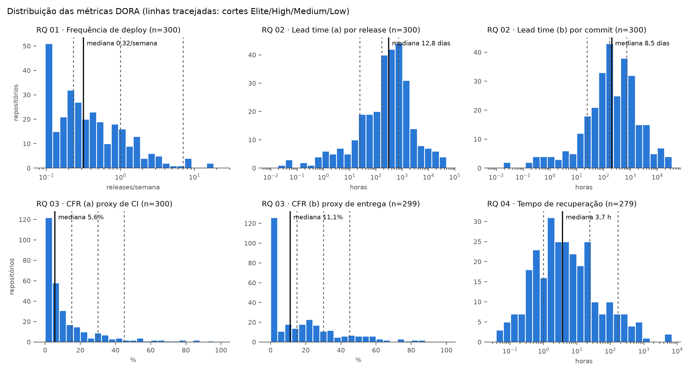
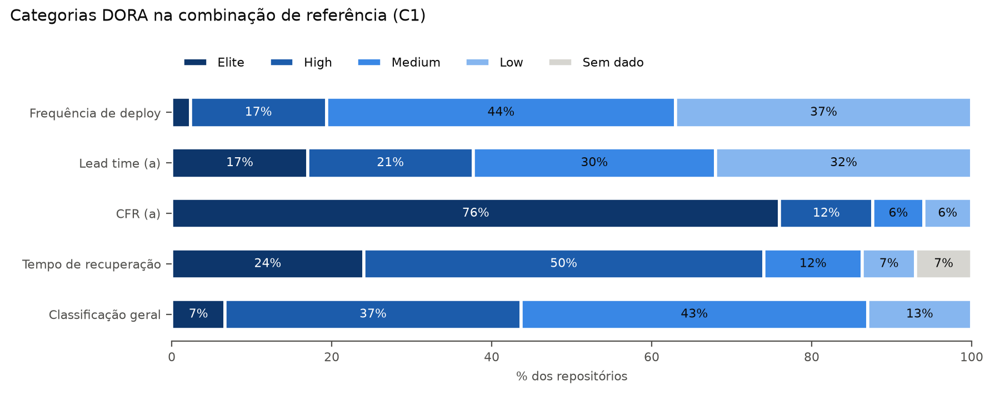
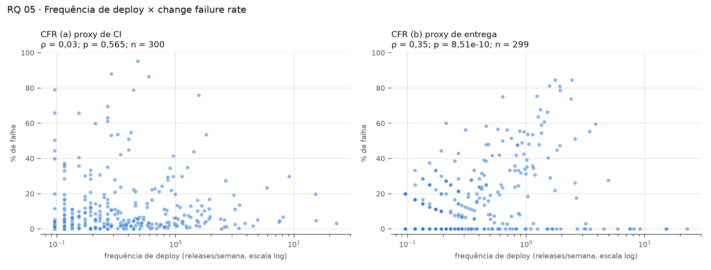
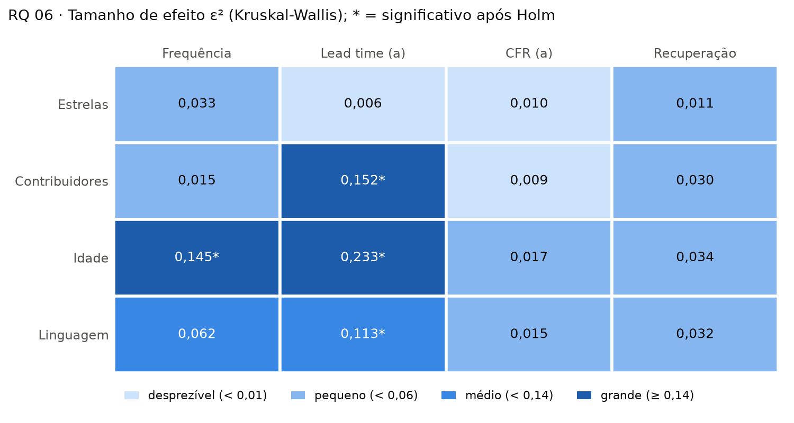

# Mineração de métricas DORA em repositórios open-source

## 1. Introdução

### 1.1 Contexto

Medir o desempenho de entrega de software é difícil porque "entregar bem" tem
duas faces que costumam ser vistas como opostas: entregar **rápido** e entregar
com **estabilidade**. O programa de pesquisa DORA (*DevOps Research and
Assessment*), popularizado pelo livro *Accelerate* (Forsgren, Humble & Kim, 2018)
e atualizado anualmente pelo relatório *Accelerate State of DevOps*, propôs quatro
métricas que se tornaram o padrão de mercado para capturar essas duas faces. Na
dimensão de velocidade estão a **frequência de deploy** e o **lead time for
changes** (tempo entre o commit e a chegada da mudança em produção). Na dimensão
de estabilidade estão a **taxa de falha das mudanças** (*change failure rate*,
CFR) e o **tempo de recuperação** após um deploy com falha, chamado de *mean time
to restore* até 2023 e de *failed deployment recovery time* desde então. Um dos
achados centrais do DORA é que velocidade e estabilidade não formam um
*trade-off*: as equipes de melhor desempenho vão bem nas duas dimensões ao mesmo
tempo.

Essas métricas foram construídas a partir de questionários respondidos por
profissionais, que relatam a própria percepção sobre a equipe. Este trabalho
investiga se elas podem ser **mineradas** automaticamente a partir dos dados
públicos de repositórios open-source no GitHub que usam integração e entrega
contínuas (CI/CD) com GitHub Actions. A dificuldade é que o GitHub não registra
"deploys em produção" nem "falhas em produção". Por isso, cada métrica é
calculada a partir de um **proxy**: uma release publicada é tratada como um
deploy; uma execução de workflow com falha, ou uma release seguida de outra
corretiva em poucos dias, é tratada como uma falha. Proxies podem distorcer o
fenômeno medido. Uma biblioteca que publica uma release por mês não está
colocando nada em produção, quem faz isso são os usuários dela.

Por esse motivo, o estudo tem dois objetivos. O primeiro é **descrever** o
desempenho DORA de repositórios populares que usam CI/CD e verificar quais
características dos projetos estão associadas a um desempenho melhor. O segundo
é **avaliar a confiabilidade das medidas**: comparamos os critérios automáticos
com o julgamento humano em uma amostra-ouro rotulada manualmente e medimos o
quanto a classificação de cada repositório muda quando a definição operacional
de deploy, lead time ou falha muda. A pergunta deixa de ser só "qual é o valor
da métrica?" e passa a ser também "o quanto podemos confiar nesse valor?".

A amostra é composta por repositórios com mais de 1.000 estrelas que usam GitHub
Actions e que, numa janela de 12 meses, publicaram ao menos 5 releases e tiveram
ao menos 50 execuções de workflow válidas no branch principal. Para cada
repositório calculamos as quatro métricas em mais de uma variante e classificamos
o desempenho em Elite, High, Medium ou Low segundo cortes adaptados dos relatórios
DORA. As questões de pesquisa (RQs) são:

- **RQ 01.** Qual a frequência de deploys dos repositórios populares que usam CI/CD?
- **RQ 02.** Qual o tempo entre um commit e seu respectivo deploy?
- **RQ 03.** Qual a taxa de falha das mudanças entregues por esses repositórios?
- **RQ 04.** Qual o tempo de recuperação após uma execução de CI/CD com falha?
- **RQ 05.** Repositórios com maior frequência de deploy apresentam maior ou menor taxa de falha?
- **RQ 06.** Quais características dos repositórios estão associadas a um melhor desempenho DORA?
- **RQ 07.** O quanto a classificação DORA de um repositório depende da definição operacional escolhida?

### 1.2 Hipóteses informais

As hipóteses abaixo foram escritas **antes** da coleta dos dados e registram o
que o grupo espera encontrar e por quê.

**H1 (RQ 01, frequência de deploy).** Esperamos uma mediana entre 0,25 e 0,75
release por semana, ou seja, de uma release por mês a uma a cada duas semanas,
o que coloca o repositório típico na categoria **Medium**, perto da fronteira
com High. Projetos open-source costumam agrupar mudanças em versões e publicá-las
num ritmo planejado, e não a cada mudança. Esperamos uma distribuição muito
assimétrica à direita: uma minoria de repositórios que publica releases
automaticamente (versões *nightly*, bots de release ou monorepos que lançam vários
pacotes) deve atingir Elite e puxar a média para cima, o que justifica reportar
mediana e IQR. O próprio critério de inclusão (≥ 5 releases em 12 meses)
garante um piso de cerca de 0,1 release por semana, então a categoria Low deve
aparecer menos do que apareceria na população geral de repositórios.

**H2 (RQ 02, lead time).** Esperamos lead times longos em comparação com as
faixas DORA. Na variante por release (a), a mediana deve ficar entre duas e
quatro semanas (**Medium**, com boa parte dos repositórios em Low). Na variante
por commit (b), deve ficar em torno de uma semana (fronteira entre **High** e
Medium). O motivo é que cada release acumula todos os commits desde a anterior,
e o commit mais antigo espera o ciclo de release inteiro. A variante (a) olha
apenas para esse commit mais antigo, enquanto a (b) olha para todos, e a maioria
dos commits fica mais perto da data de publicação. Esperamos ainda que o uso de
`commit.author.date` aumente as duas variantes: em fluxos com pull requests, o
commit é escrito dias antes de ser revisado e integrado, e rebases preservam a
data original.

**H3 (RQ 03, taxa de falha).** Na variante de CI (a), esperamos uma mediana
entre 10% e 25% de execuções com falha (entre **Elite** e **High**). Falhas no
branch principal são menos comuns que em pull requests, porque o código já passou
pela CI do PR antes do merge, mas *testes instáveis* (*flaky tests*), workflows
de documentação e falhas de infraestrutura mantêm a taxa acima de zero. Na
variante de entrega (b), esperamos uma mediana entre 10% e 20%, com grande
variação entre projetos. Projetos que seguem SemVer e publicam *patches* com
frequência devem ter CFR (b) bem mais alto que os demais, mesmo que nem todo
*patch* corrija uma falha recente. Esperamos correlação fraca entre as duas
variantes, porque elas medem fenômenos diferentes: uma falha de pipeline
raramente chega ao usuário, e um defeito que chega ao usuário quase nunca foi
detectado pela CI.

**H4 (RQ 04, tempo de recuperação).** Esperamos uma mediana de algumas horas,
entre 1 e 12 horas (categoria **High**). Uma falha no branch principal costuma
bloquear o trabalho de todos os mantenedores, então tende a ser corrigida no
mesmo dia, muitas vezes pelo próprio push seguinte. Esperamos, porém, uma cauda
longa: workflows secundários (documentação, *benchmarks*, *deploy* de sites) podem
permanecer quebrados por semanas sem que ninguém priorize a correção. Por isso
esperamos uma parcela não desprezível de **episódios censurados**, que ainda não
tinham sido resolvidos no fim da janela. Também esperamos que a recuperação seja
mais lenta em repositórios com menos contribuidores, porque há menos pessoas
disponíveis para corrigir a falha.

**H5 (RQ 05, velocidade e estabilidade).** Esperamos uma associação fraca entre
frequência de releases e CFR de CI (a). Releases frequentes podem refletir lotes
menores, mas também mais oportunidades de executar workflows com falhas. Para
CFR de entrega (b), esperamos uma associação positiva mais acentuada: projetos
que publicam muitos patches têm maior chance de satisfazer a heurística de
correção em sete dias. Essa associação pode decorrer da definição do proxy e,
isoladamente, não demonstra que entregar mais rápido reduza a estabilidade.

**H6 (RQ 06, características dos projetos).** Esperamos que projetos com mais
contribuidores tenham maior frequência de releases e menor lead time, por
disporem de mais capacidade de revisão e manutenção. Para idade e estrelas,
esperamos associações menos claras: maturidade pode melhorar a automação, mas
também acompanhar maior complexidade e ciclos de entrega mais longos. Não
assumimos uma relação causal entre popularidade e qualidade. As comparações
serão feitas entre quartis de estrelas, idade e contribuidores.

**H7 (RQ 07, sensibilidade à definição operacional).** Esperamos que a
classificação DORA de uma parcela relevante dos repositórios mude ao trocar os
proxies de deploy, lead time e falha. A inclusão de pré-releases ou tags tende
a elevar a frequência medida; a mudança de lead time por release para lead
time por commit tende a reduzir o valor mediano; e o CFR baseado em falhas de
CI pode divergir do CFR baseado em releases corretivas em até sete dias.
Nossa hipótese é que **ao menos 20%** dos repositórios classificados mudem de
categoria em pelo menos uma comparação de cenários, e que a concordância
ponderada (kappa de Cohen com pesos lineares) seja menor do que 0,80 em ao
menos uma comparação. Esses limiares são expectativas a testar, não resultados.
A análise considerará separadamente repositórios com métricas ausentes para
não confundir mudança de categoria com ausência de dados.

## 2. Metodologia

### 2.1 Fonte de dados, janela e funil de seleção

**Fonte de dados.** Todos os dados vêm da API REST pública do GitHub, coletados
por um pipeline próprio em Python. Não usamos bibliotecas prontas de acesso à
API. Usamos os endpoints de busca de repositórios, workflows e execuções do
GitHub Actions, releases, comparação entre tags (`compare`) e contribuidores. O
pipeline guarda cada resposta em cache local, o que permite retomar a coleta
depois de uma interrupção sem repetir chamadas. Ele também espera
automaticamente quando a cota da API acaba e repete com espera crescente as
requisições que falham por erro do servidor. A coleta é executada com um único
comando (`python -m pipeline --config config.yaml`), e todos os parâmetros
deste estudo ficam no arquivo `config.yaml`.

**Janela de observação.** Consideramos 12 meses, de 1º de outubro de 2025 a
30 de setembro de 2026, com os dois dias incluídos e horários em UTC. Só entram
nos cálculos as releases publicadas e as execuções de workflow criadas dentro
desse intervalo. Para o lead time, a release anterior a cada release da janela
pode estar fora dela.

**Busca de candidatos.** Buscamos repositórios com pelo menos 1.000 estrelas,
não arquivados e com algum *push* a partir do início da janela. Um repositório
sem *push* na janela não pode ter releases nem execuções nela. A API de busca
devolve no máximo 1.000 resultados por consulta. Para contornar esse limite,
dividimos a busca em faixas de estrelas que não se sobrepõem. Cada faixa com
mais de 1.000 resultados é dividida ao meio automaticamente até caber no
limite. Assim, todos os candidatos são acessíveis, e não apenas os mais
populares de cada faixa.

**Critérios de inclusão.** Os candidatos são embaralhados com semente fixa
(42) e avaliados nessa ordem até a amostra atingir o tamanho desejado. Cada
candidato passa pelos filtros abaixo, nesta ordem, e é descartado no primeiro
em que falhar:

1. o repositório responde na API;
2. usa GitHub Actions, ou seja, tem ao menos um workflow;
3. tem pelo menos 5 releases publicadas na janela (sem rascunhos nem
   pré-releases);
4. tem pelo menos 50 execuções de workflow válidas na janela: disparadas por
   `push` no *default branch* e com conclusão de sucesso ou falha.

**Funil de seleção.** A Tabela 1 mostra o funil gerado automaticamente pelo
pipeline (`dados/funil.csv`).

*Tabela 1 — Funil de seleção dos repositórios.*

| Etapa | Restantes | Descartados | Motivo do descarte |
|---|---:|---:|---|
| Candidatos da busca | 37.611 | — | — |
| Candidatos avaliados | 1.447 | 36.164 | Não avaliados: a amostra-alvo já tinha sido atingida |
| Acessíveis pela API | 1.447 | 0 | — |
| Com GitHub Actions | 1.177 | 270 | Sem workflows do GitHub Actions |
| Com ≥ 5 releases na janela | 407 | 770 | Menos de 5 releases publicadas na janela |
| Com ≥ 50 execuções válidas | 300 | 107 | Menos de 50 execuções válidas no *default branch* |
| **Amostra final** | **300** | | |

O filtro mais restritivo é o de releases: 65% dos repositórios com GitHub
Actions (770 de 1.177) não publicaram 5 releases na janela. Muitos projetos
populares usam apenas tags ou não versionam as entregas pelo mecanismo de
releases do GitHub. Isso limita a amostra a projetos que publicam releases com
regularidade, o que discutimos como ameaça à validade externa.

**Coleta detalhada e consolidação.** Para cada repositório da amostra, o
pipeline coleta o histórico de releases e os commits entre releases
consecutivas, e também as execuções de workflow da janela. Como a API devolve
no máximo 1.000 execuções por consulta, a janela é dividida por mês, e um mês
que atinge o limite é subdividido até caber. Quando um único dia passa de
1.000 execuções, a coleta de CI do repositório é marcada como incompleta e suas
métricas de CI ficam ausentes, nunca zeradas. Por fim, o script
`pipeline/consolidar.py` reúne as métricas de todas as variantes num único
arquivo (`dados/metricas_consolidadas.csv`). O significado de cada coluna está
documentado no dicionário de dados (`dados/dicionario_dados.md`).

### 2.2 Definições operacionais e variantes — pessoa B

**Unidade de entrega e frequência.** Na referência, uma entrega é uma release
publicada, estável (`draft = false`, `prerelease = false`) e com `published_at`
dentro da janela, incluindo ambos os dias extremos em UTC. A frequência é o
número dessas releases dividido pelas semanas da janela, incluindo semanas sem
publicação. As flags e o histórico são preservados para permitir outras
definições de entrega; tags são coletadas somente quando habilitadas no config.

**Lead time.** Comparamos as tags de releases estáveis consecutivas usando a API
`compare` paginada. A predecessora pode estar antes da janela. A referência da
coleta atual usa `commit.author.date`; a data de integração também é preservada.
Na variante (a), cada release contribui com o tempo desde seu commit mais antigo
até a publicação. Na variante (b), cada commit contribui com seu próprio tempo.
As medianas são calculadas, respectivamente, sobre releases e sobre commits e
expressas em horas. A primeira release da história, comparações vazias e
comparações indisponíveis não recebem lead time zero. Datas de autoria
posteriores à publicação são excluídas do cálculo e contabilizadas.

**CFR de CI, variante (a).** O módulo da pessoa C calcula a quantidade de runs
com conclusão `failure`, `timed_out` ou `startup_failure` dividida pela soma
de falhas e sucessos (`success`). Conclusões como `cancelled` ficam fora. Sem
execuções válidas, a taxa é ausente. Esse proxy descreve CI, sem identificar
necessariamente falhas experimentadas pelos usuários.

**CFR de entrega, variante (b).** A regra de referência exige conjuntamente:
(1) a release estável imediatamente seguinte preserva major/minor e aumenta
somente o patch de SemVer; (2) há uma palavra corretiva nas mensagens dos commits
entre essas tags; e (3) a publicação ocorre em até sete dias corridos. Prefixo
`v` e metadados de build são aceitos, sem alterar os números da versão. A
conjunção e o uso da próxima release estável são decisões operacionais
explicitadas porque podem mudar a sensibilidade do proxy.

Se `v2.3.0` for seguida em dois dias por `v2.3.1`, com `fix` nos commits, a
previsão é `corretiva = true` para **v2.3.1** e `falhou = true` para **v2.3.0**.
Uma passagem de `v2.4.0` para `v2.5.0` não satisfaz a regra de patch. A coluna
`corretiva` é comparada ao consenso humano da mesma tag; a coluna `falhou` é
usada no numerador do CFR. Trocar essas duas unidades produziria uma avaliação
desalinhada mesmo com uma heurística correta.

**Censura e ausências.** Originais sem sete dias completos de acompanhamento
até o fim da janela ficam fora do denominador, mesmo quando uma correção já
foi observada. Releases posteriores ao fim não completam o acompanhamento.
Uma release censurada como original ainda pode ser classificada como corretiva
de sua predecessora: a classificação própria usa apenas evidência passada.
Tags não interpretáveis em comparações necessárias, empates de publicação e
commits indisponíveis são distinguidos de negativos. A primeira release sem
predecessora tem classificação própria indeterminada. A taxa por repositório
é `falhas / denominador`, onde o denominador inclui apenas originais estáveis
na janela, com acompanhamento completo e resultado determinável. Censuras e
inconclusivos são reportados separadamente; sem denominador, a taxa é ausente.

**Integridade e reprodução.** O cálculo local usa os CSVs da coleta existente,
inclusive `commits.csv.gz`. A leitura de commits é feita em fluxo, sem guardar
todas as mensagens na memória. SHAs são deduplicados por repositório e release,
e a quantidade é conferida contra `commits_novos`; arquivos truncados ou
mensagens conflitantes geram evidência inconclusiva. As execuções registram a
versão da regra, a janela e hashes dos arquivos usados. Isso permite recalcular
o CFR (b) sem consultar novamente a API e sem alterar os dados da Sprint 1.

**Evolução da heurística.** Foram implementadas duas versões candidatas:

| Versão | Palavras nas mensagens, sem distinguir maiúsculas | F1 no consenso |
|---|---|---|
| v1 (referência) | Palavras inteiras `fix`, `hotfix`, `revert` | Pendente: consenso humano ainda não disponível |
| v2 | v1 e flexões como `fixes`, `fixed`, `fixing`, `hotfixed`, `reverted` | Pendente: consenso humano ainda não disponível |

Ambas preservam patch, conjunção e limite de sete dias. O avaliador calcula
precisão = TP/(TP+FP), recall = TP/(TP+FN) e F1 = 2TP/(2TP+FP+FN), com a
classe positiva definida como release corretiva. Cada versão efetivamente
avaliada é registrada no histórico, junto à cobertura dos rótulos e às
exclusões. A meta do enunciado é F1 ≥ 0,70; versões abaixo da meta devem ser
refinadas e avaliadas novamente. Ajustar e medir no mesmo consenso não demonstra
generalização, portanto a versão escolhida e o conjunto usado devem ser
identificados. Não se transforma uma execução sem consenso em F1 zero ou sucesso.

**Situação em 15/10/2026.** Há coleta de 100 repositórios e amostra-ouro de
60 repositórios/300 releases. Não foram disponibilizados rótulos humanos nem
consenso. A avaliação empírica, a escolha de uma versão validada e o eventual
refinamento para atingir F1 ≥ 0,70 permanecem pendentes. As datas no config
continuam marcadas como provisórias. Os testes sintéticos verificam o código,
mas não substituem a rotulagem independente nem o F1 medido na amostra-ouro.

### 2.3 Validação manual (amostra-ouro)

Várias decisões do estudo dependem de critérios automáticos que podem errar.
O caso principal é a heurística que identifica uma **release corretiva**, base
do CFR de entrega (RQ 03 b). Para medir esse erro, construímos uma
**amostra-ouro**: um subconjunto rotulado por pessoas que serve de referência
para avaliar os critérios automáticos.

**Sorteio.** Sorteamos 60 repositórios da amostra com semente fixa
(`random_state = 42`), pelo script `validacao/sorteio.py`. O sorteio foi feito
no início da coleta completa, sobre os 100 primeiros repositórios aprovados no
funil. Como o pipeline avalia os candidatos numa ordem aleatória com semente
fixa, esses 100 repositórios são um subconjunto aleatório da amostra final e
permanecem nela quando a amostra cresce. Assim, os 60 sorteados também são uma
amostra aleatória da amostra final. De cada repositório sorteamos 5 releases
estáveis (sem rascunhos nem pré-releases) publicadas na janela, também com
semente fixa, totalizando 300 releases.

**Rotulagem independente.** Os três integrantes do grupo deverão rotular a amostra
**de forma independente**, sem consultar os demais e sem acesso à saída da
heurística automática. Cada avaliador deverá usar uma cópia da planilha gerada
automaticamente, com links para o repositório, para a página de cada release
(com as *release notes*) e para a lista de commits incluídos nela. A planilha
também restringe as respostas aos valores permitidos. Serão rotuladas três
dimensões:

1. **tipo do projeto** (por repositório): biblioteca/framework,
   aplicação/serviço, ferramenta CLI ou outro. Esse rótulo é usado como fator na
   RQ 06;
2. **entregas reais** (por repositório): se as releases representam entregas
   reais ao usuário (sim, não ou incerto). Essa dimensão avalia o proxy
   "release = deploy";
3. **release corretiva** (por release): se o objetivo principal da release é
   corrigir um defeito recente (sim ou não).

**Concordância.** Após a rotulagem, calcularemos a concordância entre os três avaliadores em cada
dimensão pelo **kappa de Fleiss**, que desconta a concordância esperada por
acaso. Usamos as funções `aggregate_raters` e `fleiss_kappa` do statsmodels
(script `validacao/kappa.py`) e interpretamos os valores pela escala de Landis e
Koch (1977): abaixo de 0 pobre; até 0,20 leve; até 0,40 razoável; até 0,60
moderada; até 0,80 substancial; acima disso quase perfeita. Um kappa baixo
indica que o próprio critério é ambíguo, mesmo para pessoas, e é discutido como
achado e como ameaça à validade.

**Consenso.** O rótulo de referência de cada item é definido por **maioria
simples**: o rótulo dado por pelo menos dois dos três avaliadores. Os empates
(1-1-1) serão discutidos em reunião pelos três, e a decisão de cada caso será
registrada no repositório (`validacao/desempate.csv`), junto com a origem de
cada rótulo de consenso, maioria ou reunião (script `validacao/consenso.py`).

**Avaliação da heurística.** O rótulo de consenso de release corretiva é a
referência para calcular a precisão, o recall e o F1 da heurística automática
do CFR (b). Quando o F1 fica abaixo de 0,70, a heurística é refinada e avaliada
de novo. As versões testadas e seus resultados são descritos na seção 2.2.

<!-- Após a rotulagem: inserir a tabela com o kappa de cada dimensão
     (validacao/resultado_kappa.csv) e o número de empates resolvidos em reunião. -->

## 3. Resultados

Os resultados abaixo são calculados sobre os 300 repositórios da amostra final
pelo script `analises/rq01_04.py`, que lê `dados/metricas_consolidadas.csv`.
Como as métricas têm distribuições muito assimétricas, reportamos a mediana e o
intervalo interquartil (IQR, a faixa entre o 1º e o 3º quartil). Métricas
ausentes ficam fora de cada cálculo e nunca são tratadas como zero. A Tabela 2
resume as quatro métricas, e a Figura 1 mostra suas distribuições com os cortes
das categorias DORA.

*Tabela 2 — Estatística descritiva das métricas DORA (n = repositórios com a métrica).*

| RQ | Métrica | n | Mediana | Q1 | Q3 | IQR |
|---|---|---:|---:|---:|---:|---:|
| RQ 01 | Frequência de deploy | 300 | 0,32/semana | 0,15/semana | 0,82/semana | 0,67/semana |
| RQ 02 | Lead time (a) por release | 300 | 12,8 dias | 3,0 dias | 39,9 dias | 36,9 dias |
| RQ 02 | Lead time (b) por commit | 300 | 8,5 dias | 2,1 dias | 36,5 dias | 34,4 dias |
| RQ 03 | CFR (a) proxy de CI | 300 | 5,6% | 1,9% | 14,5% | 12,6% |
| RQ 03 | CFR (b) proxy de entrega | 299 | 11,1% | 0,0% | 27,5% | 27,5% |
| RQ 04 | Tempo de recuperação | 279 | 3,7 h | 0,9 h | 20,1 h | 19,2 h |

*Figura 1 — Histogramas das métricas. As linhas tracejadas marcam os cortes entre
as categorias DORA, e a linha contínua marca a mediana. Os eixos de frequência,
lead time e recuperação estão em escala logarítmica.*

### 3.1 RQ 01 — Frequência de deploy

O repositório típico publica **0,32 release por semana**, cerca de uma release a
cada três semanas (IQR de 0,15 a 0,82 por semana). A distribuição tem uma cauda
longa à direita: 58 repositórios (19%) publicam uma ou mais releases por semana,
e o maior valor passa de 22 por semana. Na outra ponta, 111 repositórios (37%)
publicam menos de uma release por mês. Pelos cortes DORA, a maior parte dos
repositórios fica em **Medium** (44%) ou **Low** (37%), e só 2% chegam a Elite.

### 3.2 RQ 02 — Lead time for changes

A mediana do lead time é de **12,8 dias** na variante por release (a) e de
**8,5 dias** na variante por commit (b). As duas variantes estão fortemente
correlacionadas (ρ de Spearman = 0,73), mas a variante (a) é maior em 66% dos
repositórios. Isso é esperado pela definição: a variante (a) mede o commit mais
antigo de cada release, enquanto a (b) dá o mesmo peso a todos os commits, e a
maioria deles fica mais perto da data de publicação. Um único commit antigo
"esquecido" numa release basta para aumentar a variante (a), mas pouco altera a
(b). A dispersão é grande nas duas: o IQR vai de cerca de 2 a 3 dias até quase
40 dias, e 96 repositórios (32%) ficam acima de 30 dias na variante (a), o que
corresponde à categoria Low.

### 3.3 RQ 03 — Change failure rate

As duas variantes contam histórias diferentes. Pelo proxy de CI (a), a mediana é
de **5,6%** de execuções com falha no *default branch*, e 76% dos repositórios
ficam na categoria Elite (até 15%). Pelo proxy de entrega (b), a mediana é de
**11,1%** de releases seguidas de uma release corretiva em até 7 dias, com IQR de
0% a 27,5%. Nessa variante, 121 repositórios (40%) não tiveram nenhuma release
classificada como falha. As duas variantes **praticamente não se correlacionam**
(ρ = 0,03; p = 0,56; n = 299). Um repositório com CI muito estável pode publicar
correções com frequência, e o inverso também acontece. A variante (b) depende de
uma heurística cuja validação contra a amostra-ouro é descrita na seção 2.3.

### 3.4 RQ 04 — Tempo de recuperação

Quando uma execução de CI falha no *default branch*, o mesmo workflow volta a
passar, na mediana, em **3,7 horas** (IQR de 0,9 a 20,1 horas), o que coloca
metade dos repositórios na categoria High. A cauda é longa: há repositórios cuja
mediana passa de mil horas. Foram observados 12.251 episódios de falha, dos quais
200 (1,6%) são **censurados**, ou seja, não tinham sido resolvidos até o fim da
janela. Esses episódios estão concentrados: 108 repositórios (36%) têm ao menos um
episódio censurado, mas a mediana da proporção por repositório é zero. Outros 21
repositórios (7%) não tiveram nenhum episódio resolvido na janela e ficam sem
tempo de recuperação.

### 3.5 Classificação DORA de referência (C1)

Na combinação de referência (C1: release como unidade de deploy, lead time (a),
CFR (a) e tempo de recuperação), a classificação geral fica concentrada nas
categorias intermediárias: **Medium (43%)** e **High (37%)**. Só 7% dos
repositórios são Elite e 13% são Low (Figura 2). A distribuição muda bastante de
uma métrica para outra. O CFR (a) é a métrica mais "generosa" (76% Elite), e a
frequência de deploy é a mais restritiva (só 2% Elite). Assim, na classificação
geral, o desempenho em estabilidade compensa em parte o desempenho em velocidade.

*Figura 2 — Proporção de repositórios em cada categoria DORA, por métrica e na
classificação geral (C1). "Sem dado": repositórios sem episódio de falha resolvido.*

### 3.6 RQ 05 — Frequência de deploy × taxa de falha

Calculamos a correlação de Spearman entre a frequência de deploy (RQ 01) e cada
variante do CFR (RQ 03), com o script `analises/rq05.py` (Tabela 3 e Figura 3).

*Tabela 3 — Correlação de Spearman entre frequência de deploy e CFR.*

| Par | ρ | p-valor | n | Força |
|---|---:|---:|---:|---|
| Frequência × CFR (a) proxy de CI | 0,03 | 0,57 | 300 | desprezível |
| Frequência × CFR (b) proxy de entrega | 0,35 | < 0,001 | 299 | moderada positiva |

Com o proxy de CI, **não há relação** entre publicar mais e falhar mais: a nuvem
de pontos da Figura 3 (à esquerda) é plana em toda a faixa de frequência. Com o
proxy de entrega, a relação é **moderada e positiva**: repositórios que publicam
mais releases também têm uma proporção maior de releases seguidas de uma
correção em até 7 dias.

*Figura 3 — Frequência de deploy (escala log) contra cada variante do CFR. Cada
ponto é um repositório.*

### 3.7 RQ 06 — Características associadas ao desempenho

Comparamos as quatro métricas da combinação de referência entre grupos de
quatro fatores: estrelas, contribuidores e idade, divididos em quartis, e
linguagem principal (as seis linguagens com pelo menos 15 repositórios e um grupo
"Outras"). O tipo do projeto não entrou, porque só foi rotulado nos 60
repositórios da amostra-ouro. Em cada um dos 16 pares fator × métrica, aplicamos
o teste de Kruskal-Wallis e corrigimos os p-valores pelo método de Holm. Como
tamanho de efeito, reportamos o ε² = H / (n − 1), interpretado por analogia ao
η² (0,01 pequeno; 0,06 médio; 0,14 grande). Para os fatores em quartis, também
calculamos o Cliff's delta entre o 4º e o 1º quartil, que indica a direção do
efeito (script `analises/rq06.py`). A Figura 4 resume os 16 testes, e a Tabela 4
detalha os quatro que continuam significativos após a correção.

*Figura 4 — ε² de cada teste de Kruskal-Wallis. O asterisco marca os testes com
p < 0,05 após a correção de Holm.*

*Tabela 4 — Associações significativas após a correção de Holm.*

| Fator | Métrica | ε² | p (Holm) | Medianas por grupo | δ (Q4 × Q1) |
|---|---|---:|---:|---|---:|
| Idade | Lead time (a) | 0,23 (grande) | < 0,001 | Q1 2,5 dias → Q4 38,3 dias | 0,69 (grande) |
| Contribuidores | Lead time (a) | 0,15 (grande) | < 0,001 | Q1 3,2 dias → Q4 30,0 dias | 0,61 (grande) |
| Idade | Frequência | 0,15 (grande) | < 0,001 | Q1 0,84 → Q4 0,19 por semana | −0,57 (grande) |
| Linguagem | Lead time (a) | 0,11 (médio) | < 0,001 | TypeScript 5,1 dias; C++ 37,1 dias | — |

Os resultados formam um padrão claro. **Os fatores se associam às métricas de
velocidade, mas não às de estabilidade.** Repositórios mais antigos publicam
releases com menos frequência e têm lead time bem maior. O mesmo acontece com o
lead time dos repositórios com mais contribuidores. Na linguagem, projetos em
TypeScript (5,1 dias), JavaScript (6,3) e Rust (7,1) têm lead time mediano bem
menor que os em Go (24,2) e C++ (37,1). Nenhum fator teve associação
significativa com o CFR (a) ou com o tempo de recuperação, e os efeitos nessas
métricas são todos pequenos ou desprezíveis (ε² ≤ 0,034). A popularidade
(estrelas) não se associou a nenhuma métrica depois da correção.

<!-- 3.8 RQ 07: Pessoa C. -->

## 4. Discussão

### 4.1 Hipóteses das RQ 01 a 04

**H1 (frequência) — confirmada em parte.** A mediana de 0,32 release por semana
caiu dentro da faixa esperada (0,25 a 0,75), e a distribuição tem a cauda longa
prevista, com poucos repositórios que publicam várias releases por semana. A
surpresa foi a categoria Low. Esperávamos que o critério de inclusão (5 releases
na janela) a tornasse rara, mas 37% dos repositórios ficam abaixo de uma release
por mês. O motivo é que o piso do filtro (cerca de 0,1 release por semana) está
bem abaixo do corte de Low (cerca de 0,23 por semana). Em outras palavras, um
projeto que publica entre 5 e 11 releases por ano entra na amostra e é
classificado como Low.

**H2 (lead time) — confirmada, com valores um pouco menores.** Como previsto, a
variante (a) é maior que a (b) na maioria dos repositórios, e as duas ficam
longe da faixa Elite. A variante (b) ficou na fronteira entre High e Medium
(8,5 dias), como esperado. A variante (a) ficou abaixo da faixa prevista (12,8
dias, contra 2 a 4 semanas). Uma explicação é que muitos projetos publicam
*patches* poucos dias depois de uma versão maior, e essas releases curtas puxam a
mediana por release para baixo.

**H3 (taxa de falha) — confirmada em parte.** O CFR de entrega (b) ficou dentro
da faixa prevista (11,1%), e a correlação fraca entre as duas variantes se
confirmou de forma ainda mais forte do que esperávamos (ρ = 0,03). Já o CFR de CI
(a) ficou abaixo do previsto (5,6%, contra 10% a 25%): o *default branch* de
projetos populares falha menos do que imaginávamos, provavelmente porque o código
já passou pela CI do *pull request* antes do *merge*. A falta de correlação
reforça que "falha de pipeline" e "falha percebida pelo usuário" são fenômenos
distintos. Por isso, escolher uma das duas variantes como "a" taxa de falha muda
a conclusão sobre a estabilidade de um projeto.

**H4 (recuperação) — confirmada quanto ao valor típico, não confirmada quanto
aos contribuidores.** A mediana de 3,7 horas está na faixa prevista (1 a 12 horas) e
na categoria High, e a cauda longa apareceu. A censura existe, mas é menor do que
esperávamos: 1,6% dos episódios, concentrados em pouco mais de um terço dos
repositórios. Também esperávamos uma recuperação mais lenta em repositórios com
menos contribuidores, mas a correlação observada é fraca e vai no sentido
**oposto** (ρ = 0,14; p = 0,02): repositórios com mais contribuidores demoram um
pouco mais para se recuperar. Essa associação, porém, não se mantém depois da
correção para comparações múltiplas na RQ 06 (seção 3.7), então não a tratamos
como um achado. Se ela existir, uma explicação possível é que projetos grandes
têm mais workflows secundários (documentação, *benchmarks*, publicação), que
podem ficar quebrados por mais tempo sem bloquear o trabalho principal.

### 4.2 Hipóteses das RQ 05 e 06

**H5 (velocidade e estabilidade) — confirmada.** Como previsto, a frequência de
deploy não se associa ao CFR de CI (ρ = 0,03) e se associa de forma positiva e
mais marcada ao CFR de entrega (ρ = 0,35).

**Existe trade-off entre velocidade e estabilidade?** Os dados **não sustentam um
trade-off**, mas também não reproduzem a afirmação do DORA de que as equipes
mais rápidas são também as mais estáveis. Pelo proxy de CI, velocidade e
estabilidade são simplesmente independentes: publicar mais não aumenta nem
diminui a taxa de falha do pipeline. A correlação positiva com o CFR (b) parece
um trade-off à primeira vista, mas é em boa parte um **efeito da própria
definição do proxy**, por dois motivos:

1. as releases corretivas também contam como deploys, então um projeto que
   corrige muito publica muito, e a frequência sobe junto com a taxa;
2. quem publica com frequência tem mais pares de releases separados por menos de
   7 dias, o que dá à heurística mais oportunidades de marcar uma release como
   falha.

Além disso, correlação não implica causalidade. Em qualquer dos casos, os dados
mostram associação, não que publicar mais *cause* mais correções.

**H6 (características dos projetos) — refutada para contribuidores, confirmada
para popularidade.** Esperávamos que projetos com mais contribuidores
entregassem mais rápido. Aconteceu o contrário: o lead time cresce de 3,2 dias
no quartil com menos contribuidores para 30 dias no quartil com mais. A idade
mostra o mesmo padrão, ainda mais forte, e também se associa a uma frequência
menor. As duas variáveis estão correlacionadas (ρ = 0,53 entre idade e
contribuidores), então parte do efeito dos contribuidores pode ser, na verdade,
efeito da maturidade do projeto. Uma explicação plausível é que projetos maduros
e com muitos colaboradores adotam ciclos de release mais longos e planejados,
com mais revisão e mais estabilidade de API, enquanto projetos novos publicam
pequenas versões com frequência. Para a popularidade, como esperávamos, não há
associação: ter mais estrelas não diz nada sobre o desempenho de entrega. O fato
de nenhum fator se associar às métricas de estabilidade sugere que o CFR (a) e a
recuperação dependem mais de práticas de cada projeto (testes, cultura de
revisão, workflows secundários) do que de tamanho, idade ou linguagem.

<!-- 4.3 Hipótese da RQ 07: Pessoa C. -->

## 5. Ameaças à validade

### 5.1 Validade de construto

A principal ameaça é que **nenhuma das métricas observa diretamente o fenômeno
que o DORA define**. Medimos aproximações (*proxies*), e cada uma tem um desvio
conhecido.

- **Release ≠ deploy.** Tratamos a publicação de uma release no GitHub como um
  deploy. Para bibliotecas e frameworks, publicar uma release não coloca nada em
  produção: quem faz isso são os usuários, quando atualizam a dependência. Para
  aplicações, o deploy real pode acontecer sem release (deploy contínuo a partir
  do *default branch*) ou com uma release que agrupa vários deploys. Assim, a
  frequência de deploy tende a ser **subestimada** em projetos com deploy
  contínuo e a não ter correspondente em produção para bibliotecas. A dimensão
  "entregas reais" da amostra-ouro (seção 2.3) mede o quanto esse proxy se
  sustenta no julgamento humano.
- **Falha de CI ≠ falha em produção.** O CFR (a) conta execuções de workflow com
  falha. Uma falha de pipeline quase nunca chega ao usuário, porque é justamente
  o pipeline que a barra. Ao mesmo tempo, defeitos que chegam ao usuário em geral
  passaram pela CI sem falhar. A correlação quase nula entre CFR (a) e CFR (b)
  (ρ = 0,03) é evidência empírica de que as duas variantes medem construtos
  diferentes. O mesmo vale para o tempo de recuperação, que mede quanto tempo um
  workflow fica "vermelho", e não quanto tempo os usuários ficam afetados.
- **Release corretiva como falha.** O CFR (b) depende de uma heurística (versão
  *patch*, palavras-chave e janela de 7 dias). Uma release *patch* pode corrigir
  um defeito antigo, ou só atualizar dependências, e uma correção importante
  pode sair numa versão *minor*. A precisão e o recall dessa heurística são
  medidos contra a amostra-ouro.
- **Data do commit.** O lead time usa `commit.author.date`, que registra quando a
  mudança foi escrita. *Rebases* e *squash merges* preservam ou reescrevem essa
  data, de modo que o lead time pode incluir o tempo de revisão do *pull request*
  ou, ao contrário, omiti-lo.
- **Release anterior em projetos com várias linhas de versão.** A release
  anterior é a última estável publicada antes, por data. Em projetos que mantêm
  versões em paralelo (por exemplo, correções de 1.114.x publicadas depois da
  1.115.0), a comparação cruza linhas de versão diferentes e pode inflar o número
  de commits e o lead time da release.
- **Cortes de categoria fixos.** As categorias usam cortes adaptados dos
  relatórios DORA, que definem as faixas por agrupamento das respostas de cada
  ano. Os cortes desta disciplina permitem comparar grupos, mas a classificação
  de um repositório não equivale à que ele receberia num relatório DORA.

<!-- 5.2 Validade interna e 5.3 externa: Pessoa C. -->

### 5.4 Validade de conclusão

- **Muitas comparações.** A RQ 06 faz 16 testes. Sem correção, a chance de ao
  menos um falso positivo ao nível de 5% passaria de 50%. Aplicamos a correção de
  Holm sobre os 16 testes, e só reportamos como significativos os que continuam
  abaixo de 0,05 depois dela. Quatro testes com p < 0,05 sem correção (por
  exemplo, estrelas × frequência, com p = 0,02) deixaram de ser significativos,
  e não os interpretamos.
- **Significância não é relevância.** Com n = 300, até diferenças pequenas
  podem ser significativas. Por isso reportamos o tamanho de efeito (ε² e
  Cliff's delta) em todos os testes, e a discussão se apoia nos efeitos médios e
  grandes.
- **Subgrupos pequenos.** Nos quartis, cada grupo tem cerca de 75 repositórios.
  Na linguagem, alguns grupos são pequenos (C++ tem 18, JavaScript 19), e o
  grupo "Outras" junta linguagens muito diferentes. As medianas dos grupos
  pequenos são menos estáveis.
- **Testes não paramétricos e assimetria.** Usamos Spearman, Kruskal-Wallis e
  Mann-Whitney porque as métricas têm distribuições muito assimétricas, com
  caudas longas. Esses testes comparam postos e não exigem distribuição normal,
  mas o Kruskal-Wallis indica que *alguma* distribuição difere, sem dizer qual
  grupo. O Cliff's delta entre os quartis extremos complementa essa informação.
- **Fatores correlacionados.** Idade e número de contribuidores estão
  correlacionados (ρ = 0,53). Como cada fator é testado separadamente, não é
  possível separar o efeito de um do efeito do outro.
