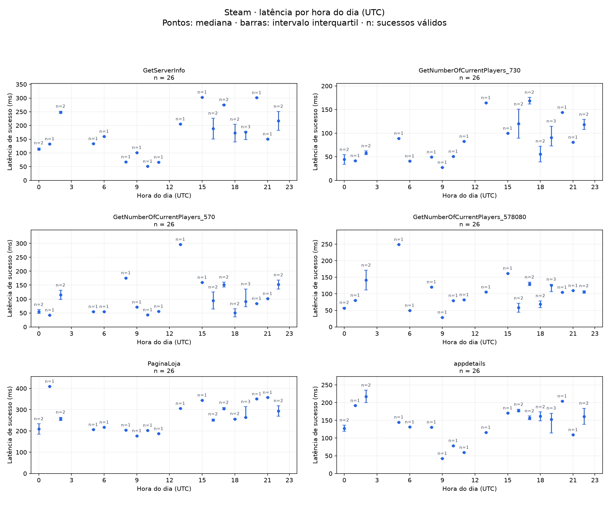
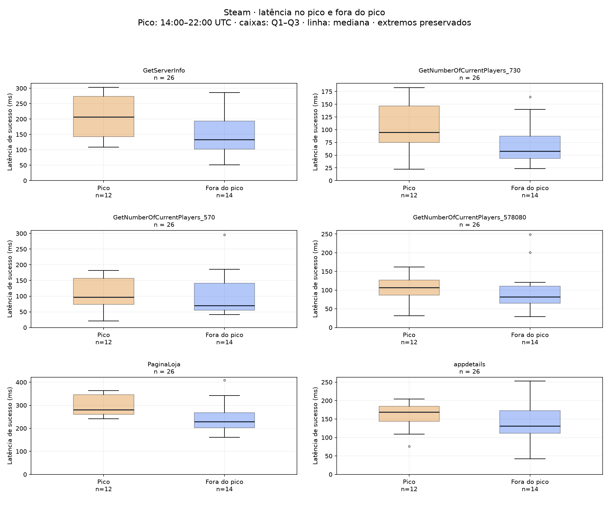
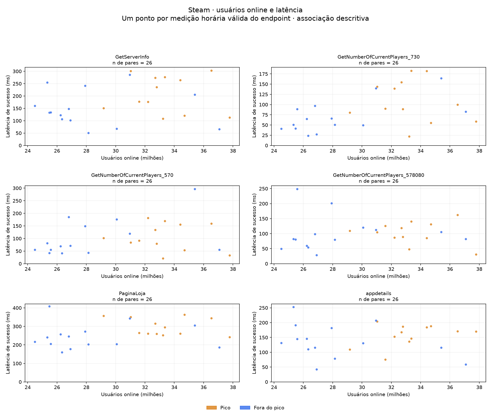

# Lab05 — Sprint 2 da Pessoa A: análise exploratória

**A coleta está em andamento. Este relatório não declara o dataset congelado nem apresenta conclusões confirmatórias.**

- Período observado: 2026-11-19T19:38:13.180000Z até 2026-11-26T20:17:08.239000Z.
- Medições de serviços antes da seleção horária: 162.
- Medições analisadas: 156; repetições de endpoint na mesma hora excluídas: 6.
- Consultas auxiliares excluídas: 27; desconhecidas excluídas: 0.
- SHA256 do CSV bruto: `fbe086f5ecf75ae832a319de31a95907cdf2828adf9c1ba98682f8b2871d6a70`.

## Método

Uma observação por endpoint e hora de calendário UTC, conservando a primeira tentativa sem escolher pelo resultado. Pico: 14h ≤ hora UTC < 22h. Janela candidata: terça 15h ≤ hora < 18h em America/Los_Angeles, com horário de verão. ValveStats é apenas fonte auxiliar. Falhas, faltantes e tentativas não classificáveis são separados. Latências de sucesso válidas e outliers são mantidos; timeouts não entram na distribuição de sucesso.

H1 usa Mann–Whitney unilateral e delta de Cliff; H2 usa Spearman unilateral; H3 usa Fisher unilateral, adequado a contagens pequenas. Todos os valores-p pressupõem observações independentes. Holm usa três hipóteses planejadas do endpoint primário e uma família separada para todos os testes secundários; hipóteses não estimáveis mantêm seu lugar na família.

## Descrição por endpoint

| endpoint | medicoes | tentativas_classificaveis | sucessos | falhas | n_latencias | mediana_ms | iqr_ms | p95_ms |
| --- | --- | --- | --- | --- | --- | --- | --- | --- |
| GetServerInfo | 26 | 26 | 26 | 0 | 26 | 155.2 | 136.6 | 297.4 |
| GetNumberOfCurrentPlayers_730 | 26 | 26 | 26 | 0 | 26 | 81.55 | 78.85 | 177.5 |
| GetNumberOfCurrentPlayers_570 | 26 | 26 | 26 | 0 | 26 | 82.75 | 99 | 184.3 |
| GetNumberOfCurrentPlayers_578080 | 26 | 26 | 26 | 0 | 26 | 93.65 | 40.5 | 191.2 |
| PaginaLoja | 26 | 26 | 26 | 0 | 26 | 260 | 89.22 | 362.1 |
| appdetails | 26 | 26 | 26 | 0 | 26 | 146 | 68.23 | 206.3 |

Proporções de sucesso são condicionais às tentativas classificáveis observadas. Não representam uptime global ou duração total de indisponibilidade. Tabelas completas: [endpoint](descritiva_endpoint.csv), [período](descritiva_periodo.csv) e [dia da semana](descritiva_dia_semana.csv). Grupos sem observações têm n=0 e estatísticas ausentes.

## Normalidade

Shapiro–Wilk é apenas diagnóstico por endpoint, período e dia da semana. Não rejeitar normalidade não prova distribuição normal nem independência. Amostra com menos de três valores ou sem variação não recebe uma conclusão artificial. A escolha dos testes de postos já foi definida na proposta e não muda para buscar significância.

Resultados completos: [normalidade.csv](normalidade.csv).

## H1–H3 do endpoint primário (GetServerInfo)

| hipotese | teste | n1 | n2 | estatistica | efeito_nome | efeito | p_valor | p_holm | status |
| --- | --- | --- | --- | --- | --- | --- | --- | --- | --- |
| H1 | Mann–Whitney U | 12 | 14 | 122 | delta de Cliff | 0.4524 | 0.02532 | 0.07596 | ok |
| H2 | Spearman | 26 | 26 | 0.1494 | rho de Spearman | 0.1494 | 0.2332 | 0.4663 | ok |
| H3 | Fisher exato | 0 | 26 | não estimável | razao de chances de falha | não estimável | não estimável | não estimável | amostra_insuficiente |

**H1:** Evidência exploratória insuficiente após Holm; não demonstra igualdade nem ausência de efeito. Valor-p sob independência; Mann–Whitney compara distribuições/postos e não é um teste geral de medianas.

**H2:** Evidência exploratória insuficiente após Holm; não demonstra igualdade nem ausência de efeito. Valor-p assintótico sob independência; associação não implica causalidade. Com até 500 pares, a aproximação do valor-p pode ser imprecisa.

**H3:** Não estimável: Faltam tentativas classificáveis na janela ou fora dela.

A diferença e a razão das medianas de H1 são descritivas; Mann–Whitney compara posições/distribuições, com condições adicionais para uma interpretação de medianas. O delta é positivo quando o pico tende a ser mais lento. Spearman mede associação monotônica e não causalidade; seu valor-p assintótico é especialmente limitado com amostras pequenas e dependência temporal. H3 requer observações dentro e fora da janela; ausência de falhas não demonstra equivalência nem disponibilidade perfeita. OR indefinida/infinita é indicada sem pseudocontagens.

Todos os testes por endpoint estão em [hipoteses.csv](hipoteses.csv).

## Cobertura e dependência temporal

| endpoint | horas_com_medicao | horas_calendario_entre_primeira_e_ultima | cobertura_calendario_observado_pct | pares_consecutivos_validos_1h | correlacao_descritiva_lag1h | status_inferencia |
| --- | --- | --- | --- | --- | --- | --- |
| GetServerInfo | 26 | 170 | 15.29 | 5 | -0.2165 | exploratoria; independência não estabelecida |
| GetNumberOfCurrentPlayers_730 | 26 | 170 | 15.29 | 5 | -0.2923 | exploratoria; independência não estabelecida |
| GetNumberOfCurrentPlayers_570 | 26 | 170 | 15.29 | 5 | -0.7143 | exploratoria; independência não estabelecida |
| GetNumberOfCurrentPlayers_578080 | 26 | 170 | 15.29 | 5 | -0.5845 | exploratoria; independência não estabelecida |
| PaginaLoja | 26 | 170 | 15.29 | 5 | -0.5019 | exploratoria; independência não estabelecida |
| appdetails | 26 | 170 | 15.29 | 5 | -0.8781 | exploratoria; independência não estabelecida |

O denominador é o calendário horário entre a primeira e a última medição de cada endpoint. Ele não mede horas futuras nem substitui a validação do agendador da Pessoa B. O diagnóstico de lag 1h usa somente pares em horas consecutivas; lacunas não são comprimidas. Não se usa correlação pequena para declarar independência.

A instrumentação mudou em 26/11/2026 para contornar omissões do agendador; a mistura de fases pode confundir horário, usuários e latência. Para analisar uma fase separada, informe --inicio e --fim com fusos explícitos. A seleção temporal deve ser registrada antes de interpretar os testes, sem escolher o período pelo menor p. Com baixa cobertura ou poucas janelas, os resultados permanecem exploratórios/descritivos; a adequação temporal e análises de robustez são etapas posteriores.

## Gráficos

## Documentação e reprodução

[Método e justificativa dos testes](../../docs/metodo_analise_sprint2.md) · [Ameaças de conclusão e construto](../../docs/ameacas_conclusao_construto.md).

Na pasta LABORATORIO 05: `.venv/bin/python -m analise.analise`. O manifesto registra dados, filtros, método, versões e hashes dos artefatos. A coleta não é disparada por esse comando.
